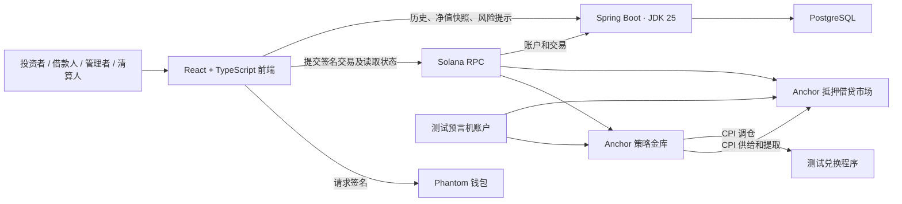

# GGBOY

GGBOY 是一个 Solana DeFi 作品。它借鉴 FBYT 的策略金库，在同一应用内提供独立运行的抵押借贷市场。投资者用测试资产买入金库份额，管理者调仓并出借闲置资金，借款人抵押资产借出测试稳定币，第三方可以清算低于健康度要求的仓位。

已实现 Devnet 钱包连接、纯现金金库存入与赎回，以及对应的历史索引、活动回执和每份净值走势。独立借贷市场已在 Devnet 初始化并登记。用户可以用 Phantom 出借 `mockUSDC`，查看链上份额、估值和当前可提取额度，并在池内可用现金范围内提取部分或全部出借资金。「我的借款」接入追加抵押、借款、还款和取回抵押品，展示链上债务、额度、健康度和最近操作。借款使用管理员发布的测试价格和固定 LTV，当前按本金结算。利用率计息、清算与策略集成见下方后续设计。 [借贷页面和操作流程](frontend/src/pages/lending/README.md)日常开发在 Localnet 进行，公开演示部署到 Solana Devnet。 [FBYT 产品说明](https://fbyt.io/product) · [FBYT 闲置资金出借](https://fbyt.io/earn)

## 整体架构



| 层 | 技术栈 | 职责 |
| --- | --- | --- |
| 前端 | React、TypeScript、Vite、Solana RPC 客户端、Anchor IDL、Phantom | 构造并预览交易，由发起方钱包签名，提交后跟踪确认状态。展示金库净值、资产配置、当前可赎回额、借贷仓位、健康度和交易历史。 |
| 后端 | **JDK 25**、Spring Boot 4.x、Spring Web、Maven、PostgreSQL、MyBatis-Plus、Flyway、OpenAPI / Swagger UI、Solana JSON-RPC/WebSocket | 索引账户与交易，提供历史、净值快照、市场和仓位查询，以及风险提示。MyBatis-Plus 负责数据访问，Flyway 管理数据库迁移。 |
| 链上 | Rust、Anchor、SPL Token、PDA、CPI | 策略金库与借贷市场分别管理各自的资产和状态。测试预言机提供可控价格，测试兑换程序执行调仓。 |

余额、份额、债务和交易是否达成均以链上状态为准。后端承担读取和索引，签名密钥由钱包持有。 [Spring Boot 兼容性](https://docs.spring.io/spring-boot/system-requirements.html) · [Solana CPI](https://solana.com/docs/core/cpi)

## 链上模块

### 策略金库

- **存入与份额**：投资者转入 `mockUSDC`，金库按操作前的净值发行份额。赎回时按操作前净值计算应付金额并销毁份额。使用整数最小单位和定点运算，约定首存价格、舍入方向及零份额处理。存入时校验最少获得份额，赎回时校验最低到账金额。
- **净值**：以 `mockUSDC` 计价，由金库现金、按有效预言机价格折算的策略资产、以及金库持有的借贷池份额价值相加得出。借贷池份额按计息且已反映已确认坏账的账面净资产估值。
- **管理与调仓**：策略管理者签名发起调仓。金库校验权限、允许的资产和兑换程序、交易额度、最小到账量及相对预言机报价的最大偏离。金库的资产账户由其 PDA 授权。
- **闲置资金出借**：金库在出借上限与现金留存约束内，通过 CPI 供给闲置 `mockUSDC`。出借仓位归金库 PDA，借贷程序按池规则处理供给和提取。
- **现金赎回**：首版以 `mockUSDC` 支付。金库先使用闲置现金，需要时在同一交易通过 CPI 从借贷池提取。策略资产按价格计入净值，换回 `mockUSDC` 后才增加可赎回现金。

```text
用户份额价值 = floor(用户份额 × 金库净值 ÷ 金库总份额)
当前可支付资金 = 金库现金 + 金库从借贷池当前可提取额
安全可赎回份额上限 = min(用户份额, floor(当前可支付资金 × 金库总份额 ÷ 金库净值))
当前可赎回额 = floor(安全可赎回份额上限 × 金库净值 ÷ 金库总份额)
```

上式适用于金库净值和总份额均大于零的情况。到账金额舍入为零时，可赎回份额上限也为零。借贷池当前可提取额受金库出借仓位价值、池内可用现金和提取限额约束。用户提交要赎回的份额数量。现金不足时整笔交易回滚，用户可改填较少份额。 [Solana 交易原子性](https://solana.com/docs/core/transactions)

### 抵押借贷市场

- **出借资金池**。当前有一个 `mockUSDC` 池。普通出借人供给资产后获得池份额，借出本金继续计入出借账本。余额来自托管现金和未偿本金，抵押品独立托管。普通出借人可按份额提取，到账向下取整并受池内已记账现金限制。后续接入金库 CPI。
- **抵押与借款**。借款人存入 `tSOL` 后可借出 `mockUSDC`、偿还本金和取回抵押品。链上检查已记账的可借现金、每个仓位的抵押额度，以及操作后是否满足 70% 借款 LTV。
- **计息设计**。后续按池资金利用率和利率模型累计利息。影响债务或份额定价的操作先更新计息，再进行业务计算。前端展示对应年化利率和利用率。
- **测试价格与健康度**。市场管理员签名发布价格，程序绑定市场价格 PDA 并用链上时钟校验 7 天有效期。80% 清算阈值用于估算健康度。价格失效时仍可还款、追加抵押或取回无债务仓位的全部抵押品。
- **清算与坏账设计**。后续第三方以自己的 `mockUSDC` 偿还满足清算条件的仓位债务，同笔交易领取按价格和清算奖励计算的抵押品。清算量受债务、单次清算比例、可用抵押品约束。抵押品耗尽后，按规则核销无法收回的剩余债务，损失反映在借贷池份额价值和金库净值中。

```text
LTV = 债务价值 ÷ 抵押品价值
健康度 = 抵押品价值 × 清算阈值 ÷ 债务价值（债务大于零时）
```

### 权限与测试依赖

- **管理员**负责初始化、配置程序认可的资产和业务参数。**策略管理者**只能通过金库指令调仓、分配和取回资金。**测试喂价人**用独立权限更新测试价格。
- 金库和借贷市场分别用自身 PDA 控制托管账户。关键指令校验签名人、账户归属、Mint、PDA 和 CPI 目标。池参数和账户由借贷程序管理，金库通过单向 CPI 使用资金池。 [Solana PDA](https://solana.com/docs/core/pda) · [Solana CPI](https://solana.com/docs/core/cpi)
- Devnet 调仓走测试兑换程序，在两种测试代币之间进行真实链上转账。真实 Jupiter Swap CPI 放在后续主网状态镜像集成测试中，届时验证具体路由和账户依赖。 [Jupiter 部署环境](https://developers.jup.ag/docs/get-started/development-basics) · [Jupiter CPI 指令](https://developers.jup.ag/docs/swap/build/common-instructions)

## 后端索引与查询

1. 后端定时从 RPC 读取已最终确认且执行成功的金库存赎及借款交易。全站「交易活动」可查看抵押、借款、还款、取回抵押品、提取出借资金和各自的回执。历史按网络、交易签名与事件序号去重，检查点支持重启后补扫。「我的借款」的近期操作仍直接读取钱包借款 PDA。出借存入和调仓事件随各自业务接入。
2. 后端定时从同一最终确认的 slot 采集纯现金金库的托管余额和份额总量。PostgreSQL 保存事件、资源目录、仓位与净值快照和同步游标。REST API 为页面提供历史、配置和快照，返回数据对应的链上 slot。已映射的数据表和 Java 类型见[数据库实体索引](backend/ggboy-app/src/main/java/io/ggboy/backend/entity/README.md)。
3. 前端通过 RPC 读取当前借款仓位、可操作额度及健康度。借款与有债务的抵押品取回由链上指令重新验证额度和价格时效。

## 开发与演示环境

| 环境 | 用途 |
| --- | --- |
| Localnet | 在本地验证器运行程序和端到端测试。初始化脚本创建资产、池和多个角色钱包，注入确定的余额、价格及测试参数。 |
| Solana Devnet | 部署程序并通过 Phantom 进行公开演示。部署钱包和支付交易费用的演示钱包需要 Devnet SOL。 |

首版由初始化脚本创建 **6 位小数的 `mockUSDC`** 和一枚测试抵押代币。测试抵押代币也可作为首版的策略兑换资产。`mockUSDC` 同时用作金库存入、赎回和借贷池结算资产。`mockUSDT` 可按同样方式添加为后续演示资产。每个网络的程序 ID、资产 Mint 和预言机地址分别配置，项目配置只记录公开地址。 [Solana 网络说明](https://solana.com/docs/references/clusters) · [Devnet SOL 水龙头](https://faucet.solana.com/) · [SPL 代币创建与铸造](https://solana.com/docs/tokens/quickstart)

## 规划目录

[前端](frontend/README.md) · [后端](backend/README.md) · [链上程序](onchain/README.md)

```text
GGBOY/
├── README.md
├── frontend/        React 前端
├── backend/         Maven 聚合工程，使用 JDK 25
│   ├── ggboy-app/   Spring Boot 服务、数据访问与数据库迁移
│   ├── ggboy-core/  业务值对象和业务类型
│   └── ggboy-common/ 公共响应、错误类型和通用校验
└── onchain/         Anchor 工作区
    ├── programs/    金库、借贷和测试兑换程序
    ├── scripts/     部署、创建测试代币与演示初始化
    └── tests/       链上业务与跨程序集成测试
```

## 开发顺序与验收

1. **搭建本地环境**。创建测试 Mint、角色钱包和可控价格账户。
2. **实现独立借贷市场**。跑通供给 → 存抵押品 → 借出 → 计息 → 还款。用测试喂价模拟价格下降，验证健康仓位禁止清算，符合条件的仓位可由第三方清算，最终坏账会冲减池净资产。
3. **实现策略金库和 CPI**。跑通存入 → 铸份额 → 管理者调仓 → 金库出借闲置资金 → 投资者赎回。验证未授权调仓和实际到账低于下限的交易会失败。
4. **验收流动性不足**。用全现金起始状态专测赎回。存入 1,000，金库向独立池出借 800，借款人借走 750。忽略利息和额度限制时，金库净值仍是 1,000，可赎回额为 250（自身现金 200 + 池内现金 50）。赎回价值 251 的份额应失败且份额、金库与池余额均不变。归还 100 后，可赎回额应恢复到 350。
5. **完成产品演示**。React 接入钱包和交易状态，部署到 Devnet。启用 Spring Boot 索引，验证事件去重、断线补扫和历史记录，并补充演示步骤。
